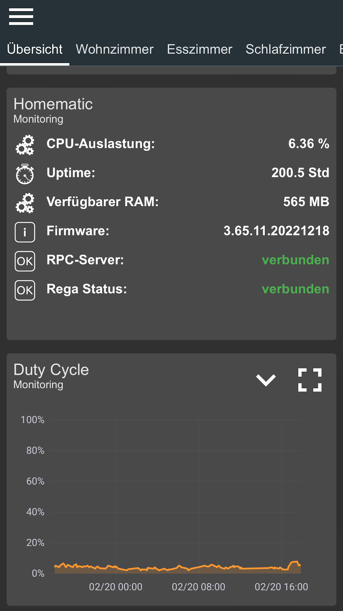
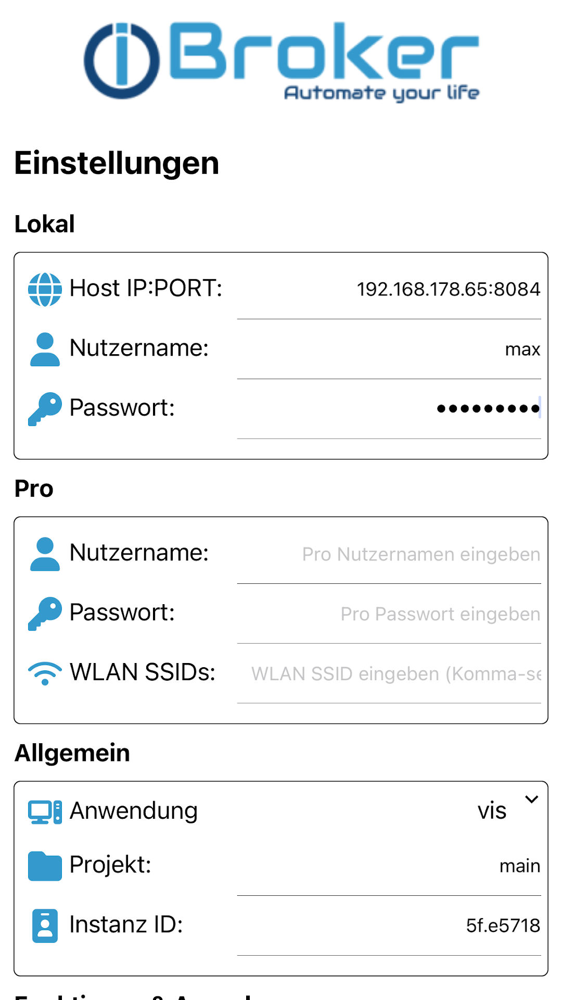
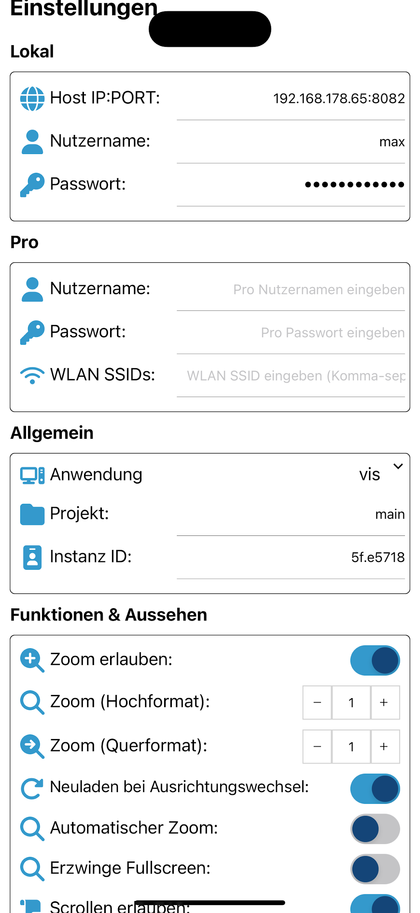
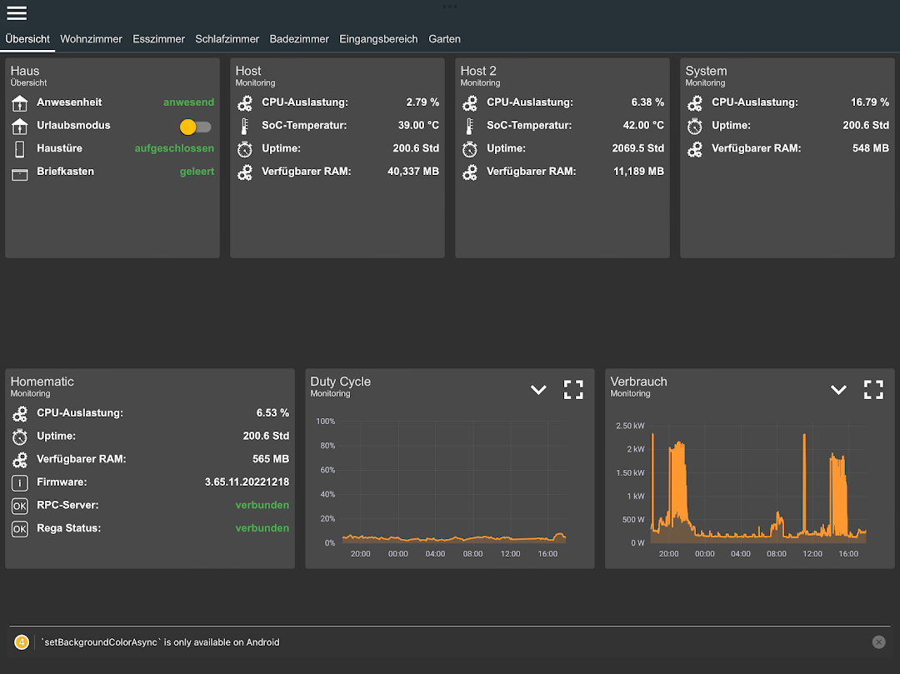
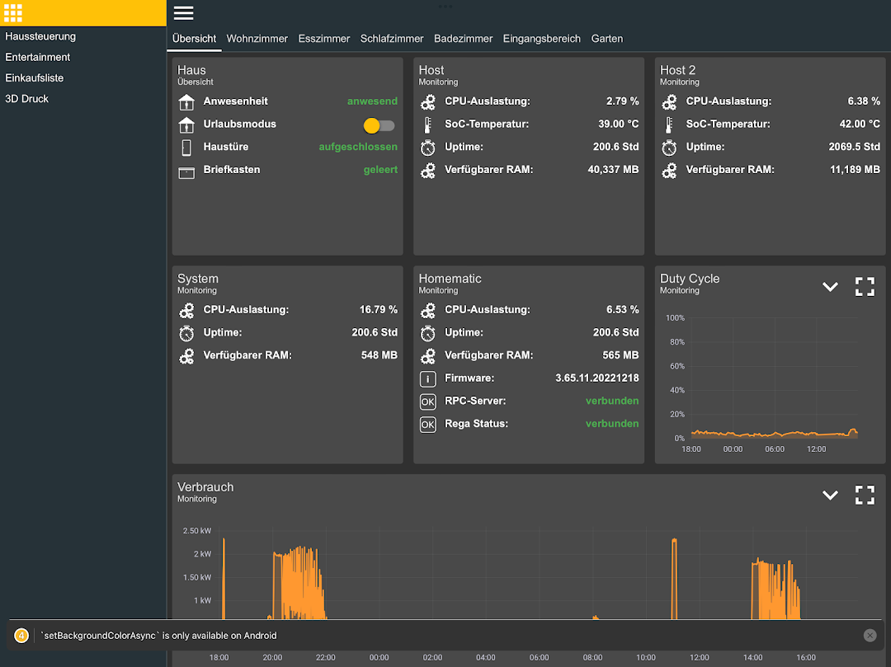
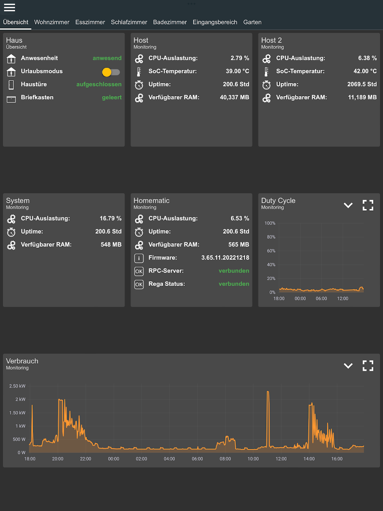
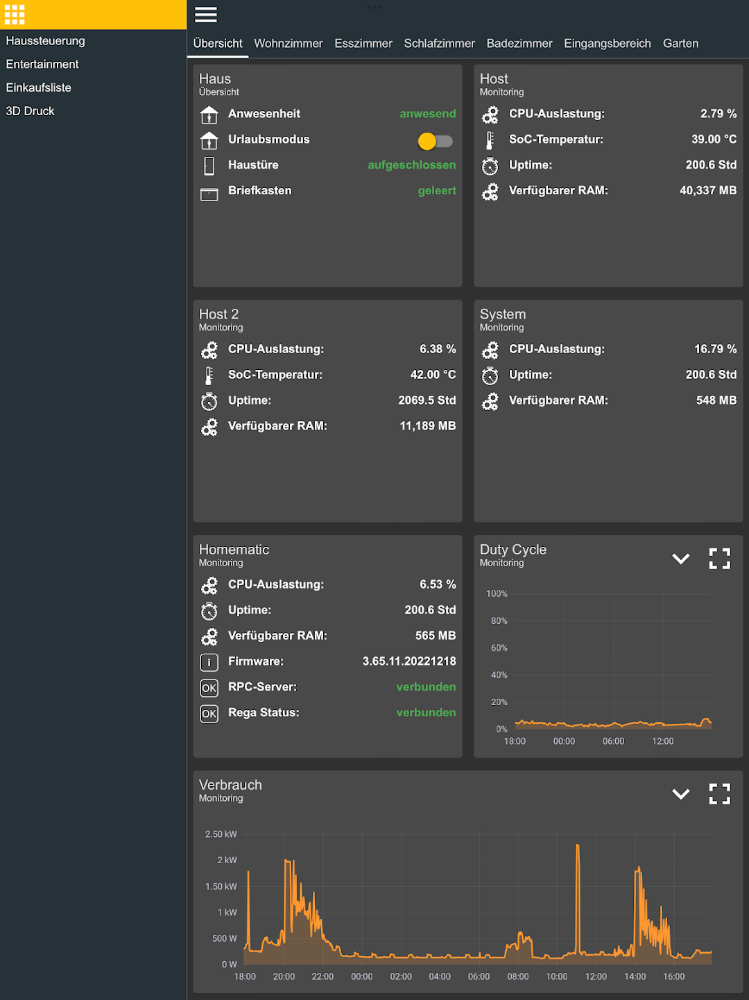
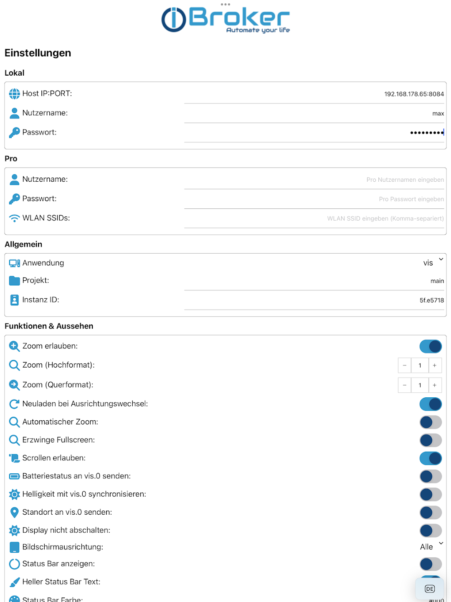

# ioBroker Visu — Android

[⬅️ Back to the overview](../README.md) · 🇩🇪 [Deutsche Version](android.de.md)

**📲 [Install from Google Play](https://play.google.com/store/apps/details?id=com.iobroker.visu)**

| | |
|---|---|
| **App name** | ioBroker Visu |
| **Package** | `com.iobroker.visu` |
| **Publisher** | ioBroker GmbH |
| **Price** | Free — no ads, no in-app purchases |
| **Category** | Lifestyle |
| **Minimum Android** | 8.0 (API 26) |
| **Languages** | English, German, Russian |
| **Store link** | <https://play.google.com/store/apps/details?id=com.iobroker.visu> |

> The predecessor app `net.iobroker.vis` is no longer developed. Please install
> **ioBroker Visu** (`com.iobroker.visu`).

---

## Screenshots

| Your visualization | Connection settings | Appearance settings |
|---|---|---|
|  |  |  |

On tablets the same views use the full width:

| Dashboard (landscape) | Navigation drawer |
|---|---|
|  |  |

| Dashboard (portrait) | Navigation drawer (portrait) | Full settings list |
|---|---|---|
|  |  |  |

*These are the current Google Play screenshots. The app is developed continuously, so the
settings screen in the latest release may be grouped differently than shown here — the
reference below describes the current structure.*

---

## What the app does

The app renders the visualization that already runs on your ioBroker installation inside a
tuned full-screen WebView, and adds the things a browser cannot do: a saved connection,
automatic local/remote switching, home-screen widgets, push notifications, device sensors,
Matter commissioning and kiosk behaviour.

### Supported visualizations

`vis-2` · `devices` · `vis` · `lovelace` · `material` · `jarvis` · `iQontrol` · `habpanel` · `aura`

The chosen type only decides which URL the app opens, so anything else reachable on your web
instance can be used as well. The default port is **8082**, except for `lovelace`, which
defaults to **8091**.

### Several visualizations in one project

A project can offer more than one visualization — `vis-2` for the rooms and `lovelace` for the
energy view, say. With more than one, a strip of tabs appears above the page. Every tab keeps
its own page: switching back finds the view, the scroll position and the connection where they
were, and a tab is only loaded the first time it is opened. *Back* steps through the page
history, then to the first tab, and only then leaves the app; the inactivity timeout returns to
the first tab and its start page.

### Connection

- **Local** — IP and port of your web instance, e.g. `192.168.1.10:8082`. A bare `IP:PORT`
  is completed automatically; `https://` may be given explicitly. An optional user name and
  password perform an automatic login. The address the app will really open — scheme, port
  and path included — is shown under the field.
- **Pro Cloud** — your [ioBroker.pro](https://iobroker.pro) account for access from outside.
  The subscription is validated against the cloud, and a Pro logo can be shown in the corner
  while the cloud connection is in use.
- **Custom cloud** — instead of ioBroker.pro, any self-hosted URL. The corner badge then reads
  `remote` instead of `.pro`.
- **Wi-Fi SSIDs** — a comma-separated list of your home networks. While connected to one of
  them the app uses the local URL, otherwise the cloud. Android tells an app the Wi-Fi name
  only with the location permission *and* with location switched on; the *Remote* tab says
  which of the two is missing. While the name cannot be read, the app asks the local
  installation whether it answers rather than going to the cloud.
- **VPN detection** — when a VPN is active the app can offer (or silently choose) the local
  URL, because through the tunnel the local address is reachable again.
- **QR code setup** — the Local tab has a scanner for the `iotConfig` code produced by
  ioBroker, which fills in port, IP, cloud user and password in one step.
- **Self-signed certificates** — can be accepted per project (tab *Others*) for local HTTPS
  instances. The exception covers the page, the login, the connection check and the list of
  vis projects alike; it is never applied to iobroker.pro. A refused certificate is named —
  untrusted, issued for another name, expired or not yet valid — instead of leaving a blank
  page or reporting "no connection".
- **Session recovery** — an expired session produces no error, only a redirect to a login
  page. The app renews the session cookie before it expires, renews again when it returns
  to the foreground, and recognises a login page by its URL to log in silently and return to
  the page you were on.

### Home-screen widgets

Two tile types — a **Toggle** that switches a state, and an **Analog** tile that shows a
numeric value as a number, half-circle gauge, horizontal or vertical bar. Both work without
opening the app, read and write local-first with a cloud fallback, and update by push.

➡️ **[widgets.md](widgets.md) — how widgets update and what you have to configure.**

### Push notifications

Messages sent from ioBroker (`iot.0.app.message`, optionally with `app.title`, `app.expire`
and `app.priority`) arrive as Android notifications with up to three action buttons; the
tapped action is written back to ioBroker. A notification can target specific devices by name
and can carry a URL to open. Push requires a valid ioBroker.pro account: the device
subscribes to a topic derived from your Pro user name.

### Device telemetry

The app can report back into ioBroker: **battery** level and charging state, **screen
brightness** (bidirectional — writing the state dims the device), **location**, **Wi-Fi
SSID**, **connection type**, a **device name** and an online indicator. Two destinations are
selectable: the `cloud` adapter (states appear under `cloud.X.devices.<device>`) or directly
under `vis.0.<device>.<field>`.

Reporting continues while the app is off screen: a WorkManager job every 15 minutes, an alarm
that also fires in doze mode, and — optionally, for devices whose manufacturer stops
background work entirely — a foreground service. The Others tab offers a shortcut to the
battery-optimisation settings when the system is still restricting the app.

### Microphone, camera and sound

A page may use the microphone and the camera — an intercom or a doorbell widget, for example.
The app asks for the Android permission the first time a page wants it, not at start-up. Sounds
may play without a tap first, so a ring tone is heard on a display nobody has touched.

> Android's WebView offers the microphone and the camera only to pages loaded over **HTTPS**
> (ioBroker.pro, or a local instance with a certificate). Over plain `http://<ip>` a page cannot
> use them; playing sounds works either way.

### Remote control (REST interface, compatible with Fully Kiosk)

The app can answer the REST interface of **Fully Kiosk Browser**, so ioBroker can control a wall
tablet: switch the screen on and off, play a ring tone, speak a text, set brightness and volume,
open a page. The [ioBroker.fullybrowser](https://github.com/arteck/ioBroker.fullybrowser) adapter
works with it unchanged.

**Setup**

1. *Others* → *Remote control*: switch on the REST interface, set a password and save. The card
   shows the address, e.g. `http://192.168.1.20:2323`.
2. In ioBroker.fullybrowser add the device with protocol `http`, this IP, port `2323` and the
   password.
3. Allow *Display over other apps* (button on the same card). Without it Android does not let
   `screenOn` and `toForeground` bring the app back from the background.

The interface keeps running while the screen is off — a foreground service with a permanent
notification — and starts again after a reboot.

**Calling it yourself** — both address forms of Fully work, e.g. from a script or Blockly:

```
http://192.168.1.20:2323/?cmd=textToSpeech&text=Es%20klingelt&password=…&type=json
http://192.168.1.20:2323/screenOn?password=…
```

Every command answers `{"status":"OK"|"Error","statustext":"…"}`; a missing or wrong password
gets `Please login`. Opened in a browser without a password, the address shows a small page
with a password field and a few commands to try.

| Command | Parameters | Effect |
|---|---|---|
| `deviceInfo` | | Battery, screen state and brightness, current page, IP, memory, volume, light sensor … as JSON |
| `listSettings` | | `screenBrightness`, `motionDetection`, `startURL` |
| `screenOn` / `screenOff` | | Wake the display / black screen (see below) |
| `startScreensaver` / `stopScreensaver` | | Dim / restore, as after inactivity |
| `triggerMotion` | | Like a touch: restore the brightness, wake the display |
| `setStringSetting` | `key=screenBrightness&value=0…255` | Display brightness; `-1` = the system's |
| `setBooleanSetting` | `key=motionDetection&value=true` | Wake the display on approach (proximity sensor) |
| `loadURL` / `loadStartURL` / `refreshTab` | `url=` | Open a page / the start page / reload |
| `playSound` / `stopSound` | `url=`, `loop=true`, `stream=3` | Play an MP3 or WAV file from a URL |
| `setAudioVolume` | `level=0…100`, `stream=3` | Volume of an audio stream |
| `textToSpeech` / `stopTextToSpeech` | `text=`, `locale=de_DE`, `queue=1` | Speak a text |
| `setOverlayMessage` | `text=` | Message over the page; an empty text removes it |
| `showToast` / `vibrate` | `text=` / `millis=` | Short message / vibration |
| `toForeground` / `toBackground` / `restartApp` / `exitApp` | | App control |
| `startApplication` | `package=` | Open another app |
| `getScreenshot` | | Screenshot as PNG |
| `clearCache` / `clearCookies` / `clearWebstorage` | | Clear web data |

Kiosk lock, camera pictures and videos are not supported and answer `Not supported`.

> **Screen off without admin rights:** an app may not switch the panel off by itself.
> `screenOff` shows a black screen with the backlight at its minimum and lets the system's own
> screen timeout switch the panel off; a touch or `screenOn` brings the page back. The status
> and navigation bar stay visible while they are set to *shown*.

### Matter

The app registers as a Matter commissioner. Scanning a device's QR code hands the
commissioning over to the ioBroker matter adapter, which adds the device to your
installation.

### Geofence

Named locations with a radius (minimum 100 m); entering or leaving one writes a boolean state
under `iot.0.app.geofence.<name>`, which the adapter creates on first use.

### Kiosk / wall-panel behaviour

Keep the display awake · dim to a chosen level after N seconds of inactivity and restore on
the next tap · return to the start page after N seconds · lock the orientation · show, hide
or make transparent the status bar (with a free colour) and the navigation bar · force full
screen · fixed zoom with two decimals (e.g. `1.15`), separately for portrait and landscape and
applied as soon as the device is turned, or automatic zoom · allow or block scrolling and
zooming · remote control by ioBroker through the
[REST interface](#remote-control-rest-interface-compatible-with-fully-kiosk).

### Projects

Up to **3 projects**, each with its own connection, visualization and appearance. A long
press on the app icon offers one shortcut per project; starting the app through a shortcut
locks it to that project until it is restarted.

### Protection

Face/fingerprint unlock can be required for the app start and for opening the settings,
independently of each other.

---

## Settings reference

The settings screen opens with a **three-finger tap** on the visualization, and is organised
in five tabs: **Local**, **Cloud**, **App**, **Others** and **Matter**.

### Local

| Setting | Meaning |
|---|---|
| Host IP:PORT | Address of the web instance, e.g. `192.168.1.10:8082`. `https://` allowed |
| User name / Password | ioBroker user for the automatic login |
| QR scanner | Reads an `iotConfig` code and fills in the fields |
| Address used | Shown under the field: the complete address the app will open |

### Cloud

| Setting | Meaning |
|---|---|
| Cloud type | `Pro` (iobroker.pro) or `Custom` |
| Cloud URL | Only for `Custom` |
| User name / Password | ioBroker.pro account — also enables push notifications |
| Wi-Fi SSIDs | Comma-separated home networks; inside them the local URL is used |
| VPN detection / auto-confirm | Use the local URL while a VPN is active, asking or silently |

### App

| Setting | Meaning |
|---|---|
| Applications | Which visualizations the project offers: `vis-2`, `devices`, `vis`, `lovelace`, `material`, `jarvis`, `iQontrol`, `habpanel`, `aura`. Several become [tabs](#several-visualizations-in-one-project) |
| Project | vis project name, default `main`. The projects found on the installation are offered; if there is only one, it is chosen |
| URL postfix | Appended to the URL, e.g. `#myStartView` |
| Instance ID | Identifies this device for `vis.0.control` (switch views, detect the active view) |

Each application has a card of its own with these fields; the arrows in its heading move it
through the tab order.

### Others

| Setting | Meaning |
|---|---|
| Allow zoom / Allow scrolling | Enable or block the gestures in the WebView |
| Zoom (portrait) / Zoom (landscape) | Fixed initial scale per orientation, typed with two decimals |
| Automatic zoom | Sets `width=device-width`, so the page scales itself |
| Force full screen | Sets `viewport-fit=cover` |
| Reload on orientation change | Helps with views that do not re-layout cleanly |
| Orientation | Lock to portrait or landscape |
| Status bar | Shown, hidden or transparent, with a free colour and light text |
| Navigation bar | Shown, hidden or transparent (Android only) |
| Keep display awake | Prevents the screen from turning off |
| Dim after seconds / Dim to level | Dim after inactivity, restore on the next tap (`0` = off) |
| Back to start page after seconds | Return to the start view after inactivity (`0` = off) |
| Reload when the app becomes active | Hard reload when returning from the background |
| Two-finger double tap reloads | Enable or disable the reload gesture |
| Telemetry target | `cloud` adapter or `vis.0` |
| Battery / Location / Brightness / Device name | Which values are reported |
| Report permanently in the background | Foreground service with a permanent notification, for devices that block background work |
| Battery optimisation | Shortcut to the system setting |
| Device name | Name used for the states of this device |
| Show Pro logo | Indicator in the corner while the cloud connection is in use |
| Protect app start / Protect settings | Biometric lock |
| Language / Dark mode | App language (EN/DE/RU) and theme |
| Accept self-signed certificates | For local HTTPS instances with their own certificate |
| REST interface | On/off, port, password, wake on approach — see [Remote control](#remote-control-rest-interface-compatible-with-fully-kiosk) |

### Matter

Selection of the matter instance and the commissioning dialog.

---

## Gestures

| Gesture | Effect |
|---|---|
| Three-finger tap | Open the settings |
| Two-finger double tap | Reload the page (can be switched off) |
| Tap after dimming | Restore the previous brightness |
| Tap on the black screen | Back from `screenOff` of the REST interface |
| Long press on the app icon | Start a specific project |

The first visualization the app ever shows carries a short hint about the three-finger tap,
once. A visualization can also open the settings itself, which is the dependable way on a wall
display where three fingers are awkward:

```js
window.ReactNativeWebView.postMessage(JSON.stringify({ command: 'openSettings' }));
```

---

## Troubleshooting

| Symptom | Cause / remedy |
|---|---|
| Settings open on every start | The connection test failed — check IP, port, credentials and whether the web instance is running |
| Blank page | Wrong application type or wrong project name; check the port (8082, lovelace 8091) |
| Works at home, not outside | No cloud configured, or the Wi-Fi SSID list is missing, so the app keeps trying the local address |
| Keeps returning to the login page | Credentials wrong, or the user lacks permission for the view |
| Widget tile stays empty | See [widgets.md](widgets.md) — usually the `/state/` endpoint of the web adapter |
| No push notifications | ioBroker.pro credentials missing or invalid; push is tied to a valid Pro account |
| Background values stop at night | Doze mode — exclude the app from battery optimisation, or enable permanent background reporting |
| "SSL error" instead of the page | The certificate is self-signed or issued for another name — enable *Accept self-signed certificates* in the *Others* tab |
| Home network not recognised | Reading the Wi-Fi name needs the location permission and location switched on — the *Remote* tab says which is missing |
| Microphone or camera do not work in the page | Only available over HTTPS — see [Microphone, camera and sound](#microphone-camera-and-sound) |
| `screenOn` / `toForeground` answer with an error | Allow *Display over other apps* for the app (button on the *Remote control* card) |

---

## Reporting a bug

[Open an issue](https://github.com/ioBroker/Android-And-iPhone-Apps/issues/new/choose) and
include the Android version, the device model, the app version (bottom of the settings
screen), the visualization used and the connection type. Redact IP addresses, user names and
passwords in screenshots.
