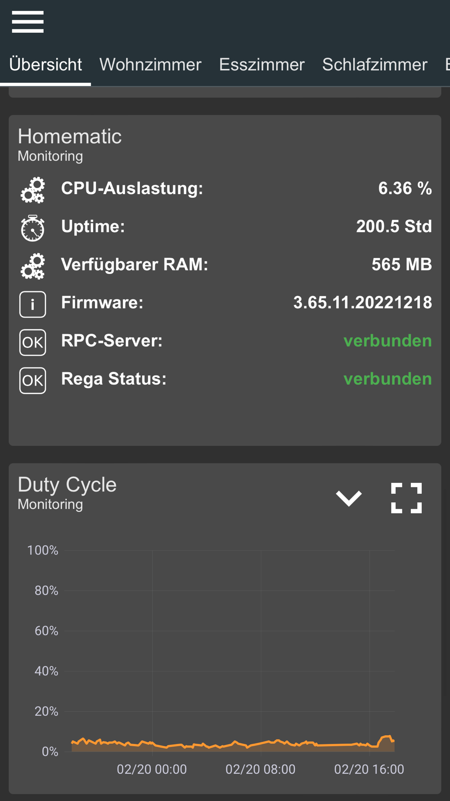
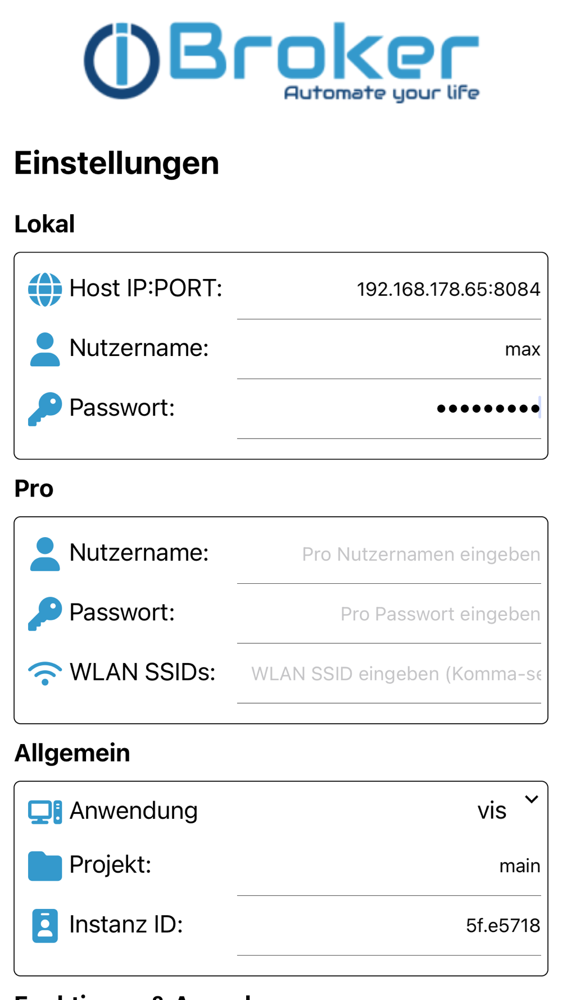
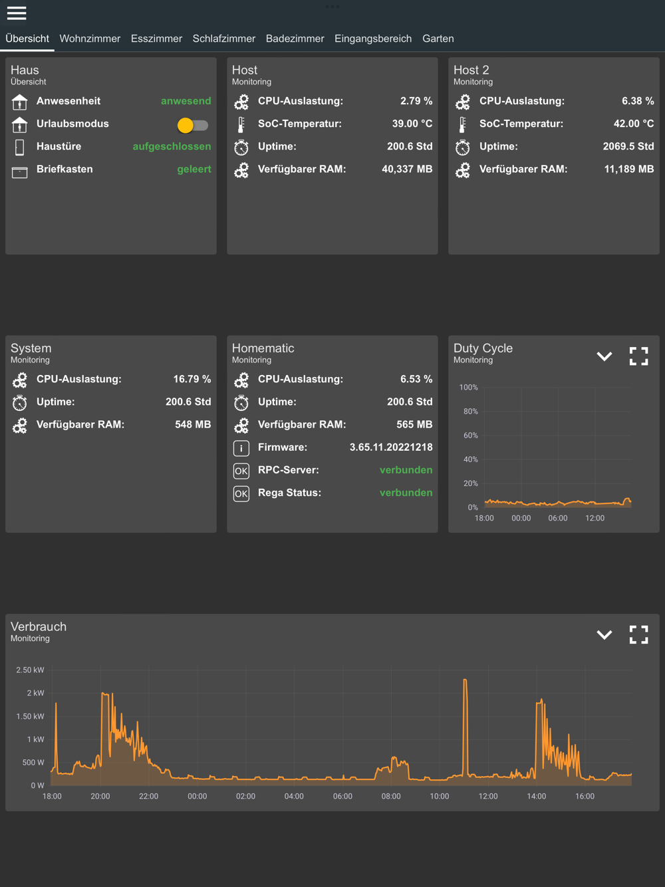
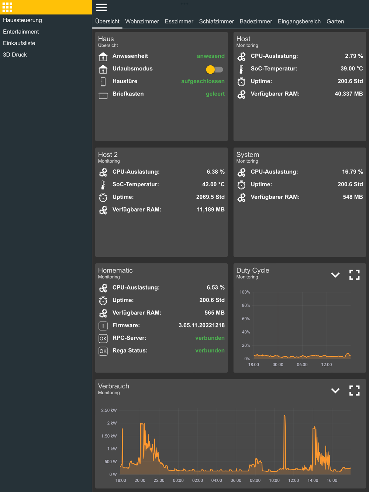
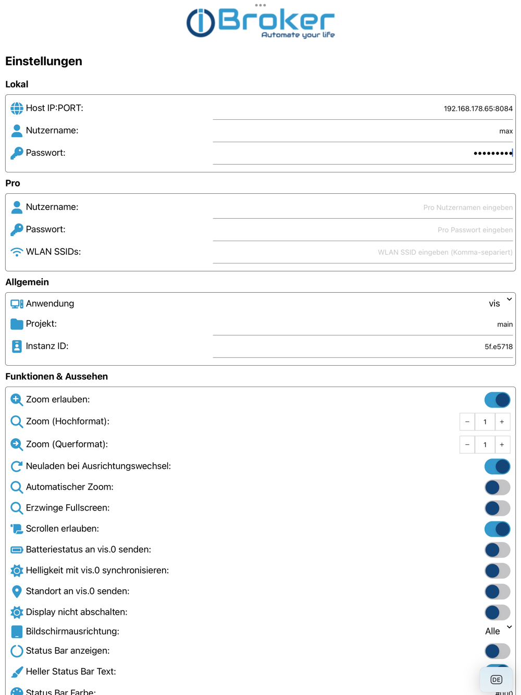

# ioBroker Visu — iPhone & iPad

[⬅️ Zurück zur Übersicht](../README.de.md) · 🇬🇧 [English version](ios.md)

**📲 [Im App Store installieren](https://apps.apple.com/app/iobroker-visu/id1673095774)**

| | |
|---|---|
| **App-Name** | ioBroker Visu |
| **Bundle-ID** | `com.iobroker.visu` |
| **Anbieter** | ioBroker GmbH |
| **Preis** | Kostenlos — keine Werbung, keine In-App-Käufe |
| **Kategorie** | Lifestyle |
| **Voraussetzung** | iOS / iPadOS 16.1 oder neuer |
| **Geräte** | iPhone, iPad, Mac mit Apple-Silicon |
| **Sprachen** | Englisch, Deutsch, Russisch |
| **Store-Link** | <https://apps.apple.com/app/iobroker-visu/id1673095774> |

> Im App Store gibt es noch eine ältere App, die schlicht **ioBroker** heißt
> ([id1449564305](https://apps.apple.com/app/iobroker/id1449564305)). Sie ist der Vorgänger
> und wird nicht mehr weiterentwickelt. Bitte **ioBroker Visu** installieren.

---

## Screenshots

| Deine Visualisierung | Verbindungseinstellungen |
|---|---|
|  |  |

Auf dem iPad nutzen dieselben Ansichten die volle Breite:

| Dashboard | Navigationsmenü | Vollständige Einstellungsliste |
|---|---|---|
|  |  |  |

*Das sind die aktuellen App-Store-Screenshots. Die App wird laufend weiterentwickelt, der
Einstellungsbildschirm der neuesten Version kann daher anders gegliedert sein als hier zu
sehen — die Referenz unten beschreibt die aktuelle Struktur.*

---

## Funktionsumfang

Die App zeigt die Visualisierung, die ohnehin schon auf deiner ioBroker-Installation läuft, in
einer darauf abgestimmten Vollbild-`WKWebView` und ergänzt alles, was Safari nicht kann: eine
gespeicherte Verbindung, automatisches Umschalten zwischen lokal und extern,
Homescreen-Widgets, Push-Benachrichtigungen, Gerätesensoren, Matter-Inbetriebnahme und
Kiosk-Verhalten.

Die iOS- und die Android-App teilen sich ein Einstellungsmodell, jede Option bedeutet auf
beiden dasselbe — die Unterschiede stehen unter [Unterschiede zu
Android](#unterschiede-zu-android).

### Unterstützte Visualisierungen

`vis-2` · `vis` · `lovelace` · `material` · `jarvis` · `iQontrol` · `habpanel` · `devices`

Die Auswahl bestimmt lediglich, welche URL die App öffnet — alles andere, was deine
web-Instanz ausliefert, lässt sich ebenfalls verwenden. Standardport ist **8082**, außer bei
`lovelace`: dort **8091**.

### Verbindung

- **Lokal** — IP und Port der web-Instanz, z. B. `192.168.1.10:8082`. Ein reines `IP:PORT`
  wird automatisch vervollständigt, `https://` kann explizit angegeben werden. Benutzername
  und Passwort führen optional einen automatischen Login durch.
- **Pro-Cloud** — dein [ioBroker.pro](https://iobroker.pro)-Konto für den Zugriff von außen.
  Das Abonnement wird gegen die Cloud geprüft; auf Wunsch zeigt ein Pro-Logo in der Ecke an,
  dass gerade die Cloud-Verbindung genutzt wird.
- **Eigene Cloud** — statt ioBroker.pro eine beliebige selbst betriebene URL.
- **WLAN-SSIDs** — kommagetrennte Liste deiner Heimnetze. Solange eines davon verbunden ist,
  nutzt die App die lokale URL, sonst die Cloud.
- **QR-Code-Einrichtung** — im Tab *Lokal* liest ein Scanner den von ioBroker erzeugten
  `iotConfig`-Code und füllt Port, IP, Cloud-Benutzer und Passwort in einem Schritt aus.
- **Sitzungswiederherstellung** — eine abgelaufene Sitzung erzeugt keinen Fehler, sondern nur
  eine Weiterleitung auf eine Login-Seite. Die App erneuert das Sitzungs-Cookie vor Ablauf,
  erneuert es erneut beim Zurückkehren in den Vordergrund und erkennt eine Login-Seite an
  ihrer URL, meldet sich still neu an und kehrt zur vorherigen Seite zurück. Genau das hält
  ein fest montiertes iPad angemeldet.

### Homescreen-Widgets

Zwei Kacheltypen — ein **Toggle**, der einen Datenpunkt schaltet, und eine **Analog**-Kachel,
die einen Zahlenwert anzeigt. Es gibt sie in zwei Ausprägungen: ein **Übersichts**-Widget, das
die ersten konfigurierten Kacheln zeigt und auf jedem unterstützten System läuft, und ein
**Einzel**-Widget für eine ausgewählte Kachel, das iOS 17 voraussetzt.

➡️ **[widgets.de.md](widgets.de.md) — wie Widgets aktualisiert werden und was dafür
einzurichten ist.**

### Push-Benachrichtigungen

Aus ioBroker gesendete Nachrichten (`iot.0.app.message`, optional mit `app.title`,
`app.expire` und `app.priority`) kommen als iOS-Benachrichtigung mit Aktionsknöpfen an; die
gedrückte Aktion wird nach ioBroker zurückgeschrieben. Eine Benachrichtigung kann gezielt
bestimmte Geräte ansprechen und eine zu öffnende URL mitführen. Push setzt ein gültiges
ioBroker.pro-Konto voraus.

### Gerätedaten (Telemetrie)

Die App kann nach ioBroker zurückmelden: **Akkustand** und Ladezustand,
**Bildschirmhelligkeit** (in beide Richtungen — ein Schreiben auf den Datenpunkt dimmt das
Gerät), **Standort**, **WLAN-SSID**, **Verbindungsart**, einen **Gerätenamen** und eine
Online-Anzeige. Zwei Ziele sind wählbar: der `cloud`-Adapter (Datenpunkte unter
`cloud.X.devices.<Gerät>`) oder direkt `vis.0.<Gerät>.<Feld>`.

Solange die Visualisierung auf dem Bildschirm ist, meldet die App alle 45 Sekunden über deren
Verbindung. Im Hintergrund führt `BGTaskScheduler` etwa alle 15 Minuten eine Runde aus — den
genauen Zeitpunkt bestimmt iOS, der Takt ist also ein Ziel und keine Zusage. Für ein Gerät,
das durchgehend melden muss, gibt es einen optionalen Modus, der den Prozess über
Standort-Updates am Leben hält; er kostet die Standortberechtigung „Immer“ und die sichtbare
Standortanzeige.

### Matter

Die App bringt eine Apple-`MatterSupport`-Erweiterung zur Geräteeinrichtung mit. Der
gescannte QR-Code eines Geräts wird an den ioBroker-Matter-Adapter übergeben, der das Gerät in
deine Installation aufnimmt.

### Geofence

Benannte Orte mit Radius (mindestens 100 m); Betreten oder Verlassen schreibt einen
booleschen Datenpunkt unter `iot.0.app.geofence.<Name>`, den der Adapter bei der ersten
Verwendung anlegt.

### Kiosk- und Wandpanel-Verhalten

Display wachhalten · nach N Sekunden Inaktivität auf einen gewählten Wert dimmen und beim
nächsten Tippen zurückstellen · nach N Sekunden zur Startseite zurückkehren · Ausrichtung
sperren · Statusleiste (mit frei wählbarer Farbe) anzeigen, ausblenden oder transparent
schalten · Vollbild erzwingen · fester oder automatischer Zoom, getrennt für Hoch- und
Querformat · Scrollen und Zoomen erlauben oder sperren.

### Projekte

Bis zu **3 Projekte**, jedes mit eigener Verbindung, Visualisierung und Darstellung. Ein
langer Druck auf das App-Icon bietet je Projekt eine Quick Action an; wird die App darüber
gestartet, bleibt sie bis zum Neustart auf diesem Projekt.

### Schutz

Face ID / Touch ID lässt sich unabhängig voneinander für den App-Start und für das Öffnen der
Einstellungen verlangen.

---

## Einstellungsreferenz

Die Einstellungen öffnen sich mit einem **Drei-Finger-Tipp** auf die Visualisierung und sind
in fünf Tabs gegliedert.

### Lokal

| Einstellung | Bedeutung |
|---|---|
| Host IP:PORT | Adresse der web-Instanz, z. B. `192.168.1.10:8082`. `https://` erlaubt |
| Benutzername / Passwort | ioBroker-Benutzer für den automatischen Login |
| QR-Scanner | Liest einen `iotConfig`-Code und füllt die Felder aus |

### Pro-Cloud

| Einstellung | Bedeutung |
|---|---|
| Cloud-Typ | `Pro` (iobroker.pro) oder `Custom` |
| Cloud-URL | Nur bei `Custom` |
| Benutzername / Passwort | ioBroker.pro-Konto — aktiviert auch Push-Benachrichtigungen |
| WLAN-SSIDs | Kommagetrennte Heimnetze; darin wird die lokale URL genutzt |

### Anwendung

| Einstellung | Bedeutung |
|---|---|
| Anwendung | `vis-2`, `vis`, `lovelace`, `material`, `jarvis`, `iQontrol`, `habpanel`, `devices` |
| Projekt | Name des vis-Projekts, Standard `main` |
| URL-Postfix | Wird an die URL angehängt, z. B. `#meineStartView` |
| Instanz-ID | Kennzeichnet dieses Gerät für `vis.0.control` (Views umschalten, aktive View erkennen) |

### Sonstiges

| Einstellung | Bedeutung |
|---|---|
| Zoom erlauben / Scrollen erlauben | Gesten in der WebView zulassen oder sperren |
| Zoom (Hochformat) / Zoom (Querformat) | Fester Anfangszoom je Ausrichtung |
| Automatischer Zoom | Setzt `width=device-width`, die Seite skaliert sich selbst |
| Vollbild erzwingen | Setzt `viewport-fit=cover` |
| Neuladen bei Ausrichtungswechsel | Hilft bei Views, die sich nicht sauber neu anordnen |
| Ausrichtung | Auf Hoch- oder Querformat festlegen |
| Statusleiste | Sichtbar, ausgeblendet oder transparent, mit freier Farbe und hellem Text |
| Display nicht abschalten | Verhindert, dass der Bildschirm ausgeht |
| Dimmen nach Sekunden / Dimmen auf | Nach Inaktivität dimmen, beim nächsten Tippen zurück (`0` = aus) |
| Nach Sekunden zur Startseite | Nach Inaktivität zur Start-View zurück (`0` = aus) |
| Neuladen, wenn die App aktiv wird | Harter Reload beim Zurückkehren aus dem Hintergrund (unter iOS standardmäßig an) |
| Telemetrie-Ziel | `cloud`-Adapter oder `vis.0` |
| Akku / Standort / Helligkeit / Gerätename | Welche Werte gemeldet werden |
| Dauerhaft im Hintergrund melden | Hält das Melden über Standort-Updates am Leben; benötigt die Berechtigung „Immer“ |
| Gerätename | Name für die Datenpunkte dieses Geräts |
| Pro-Logo anzeigen | Anzeige in der Ecke, solange die Cloud-Verbindung genutzt wird |
| App-Start schützen / Einstellungen schützen | Face-ID-/Touch-ID-Sperre |
| Sprache / Dunkles Design | App-Sprache (EN/DE/RU) und Erscheinungsbild |

### Matter

Auswahl der Matter-Instanz und der Inbetriebnahme-Dialog.

---

## Gesten

| Geste | Wirkung |
|---|---|
| Drei-Finger-Tipp | Einstellungen öffnen |
| Nach unten ziehen | Seite neu laden — nur, wenn die Seite bereits ganz oben steht |
| Tippen nach dem Dimmen | Vorherige Helligkeit wiederherstellen |
| Langer Druck auf das App-Icon | Ein bestimmtes Projekt starten (Quick Action) |

---

## Unterschiede zu Android

| Thema | iOS |
|---|---|
| Interaktive Widgets | Das Schreiben direkt von der Kachel braucht iOS 17. Unter iOS 16 öffnet ein Tipp die App, die dann schreibt |
| Reload-Geste | Nach unten ziehen statt Zwei-Finger-Doppeltipp |
| Navigationsleiste | Nur unter Android — iOS hat keine Entsprechung |
| Hintergrundmeldungen | `BGTaskScheduler`; iOS bestimmt den Takt, eine Runde alle 15 Minuten ist nicht garantiert |
| Matter | Apples `MatterSupport`-Erweiterung statt Google Play Services |
| VPN-Erkennung | Nicht verfügbar — iOS lässt Apps den VPN-Zustand weder lesen noch steuern |

---

## Problembehebung

| Symptom | Ursache / Abhilfe |
|---|---|
| Einstellungen öffnen sich bei jedem Start | Der Verbindungstest ist fehlgeschlagen — IP, Port, Zugangsdaten und ob die web-Instanz läuft prüfen |
| Weiße Seite | Falscher Anwendungstyp oder falscher Projektname; Port prüfen (8082, lovelace 8091) |
| Funktioniert zu Hause, nicht unterwegs | Keine Cloud eingerichtet oder die WLAN-SSID-Liste fehlt, sodass die App weiter die lokale Adresse versucht |
| Landet immer wieder auf der Login-Seite | Zugangsdaten falsch oder der Benutzer hat keine Rechte für die View |
| Ziehen nach unten lädt nicht neu | So gewollt — die Geste greift nur, wenn die Seite schon ganz oben steht, damit das Hochscrollen einer langen View nicht neu lädt |
| Widget-Kachel bleibt leer | Siehe [widgets.de.md](widgets.de.md) — meist der `/state/`-Endpunkt des web-Adapters |
| Einzel-Widget wird nicht angeboten | Es braucht iOS 17; unter iOS 16 das Übersichts-Widget verwenden |
| Keine Push-Benachrichtigungen | ioBroker.pro-Zugangsdaten fehlen oder sind ungültig; Push hängt an einem gültigen Pro-Konto |
| Hintergrundwerte kommen unregelmäßig | Unter iOS normal — das System legt die Zeitpunkte der Hintergrundrunden fest |

---

## Fehler melden

[Ein Issue anlegen](https://github.com/ioBroker/Android-And-iPhone-Apps/issues/new/choose) und
iOS-Version, Gerätemodell, App-Version (unten auf dem Einstellungsbildschirm), verwendete
Visualisierung und Verbindungsart angeben. IP-Adressen, Benutzernamen und Passwörter in
Screenshots unkenntlich machen.
