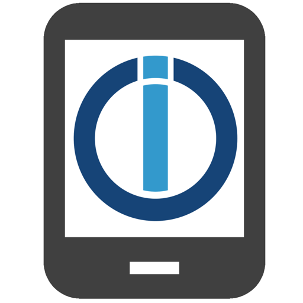

# ioBroker Visu — iPhone & iPad

[⬅️ Back to the overview](../README.md) · 🇩🇪 [Deutsche Version](ios.de.md)

**📲 [Install from the App Store](https://apps.apple.com/app/iobroker-visu/id1673095774)**

| | |
|---|---|
| **App name** | ioBroker Visu |
| **Bundle id** | `com.iobroker.visu` |
| **Seller** | ioBroker GmbH |
| **Price** | Free — no ads, no in-app purchases |
| **Category** | Lifestyle |
| **Requires** | iOS / iPadOS 16.1 or later |
| **Devices** | iPhone, iPad, Mac with Apple silicon |
| **Languages** | English, German, Russian |
| **Store link** | <https://apps.apple.com/app/iobroker-visu/id1673095774> |

> There is an older app simply called **ioBroker**
> ([id1449564305](https://apps.apple.com/app/iobroker/id1449564305)) in the App Store. It is
> the predecessor and is no longer developed. Please install **ioBroker Visu**.

---

## Screenshots

The settings are organised in five tabs, with the project selector above them:

| Local | Pro Cloud | Application |
|---|---|---|
| 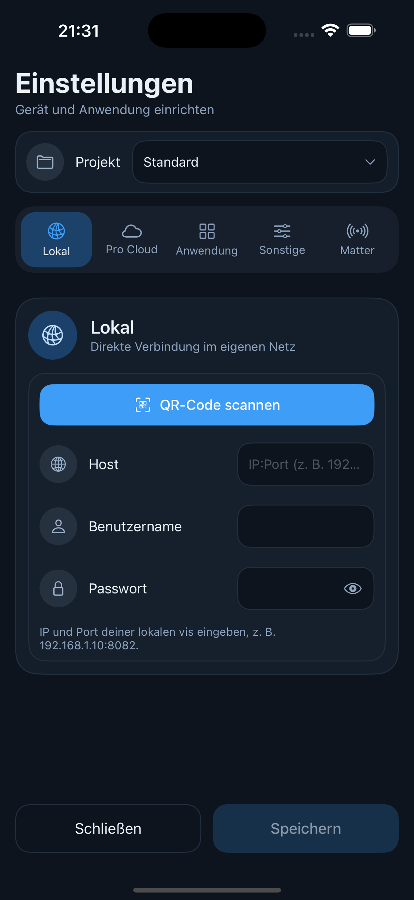 | 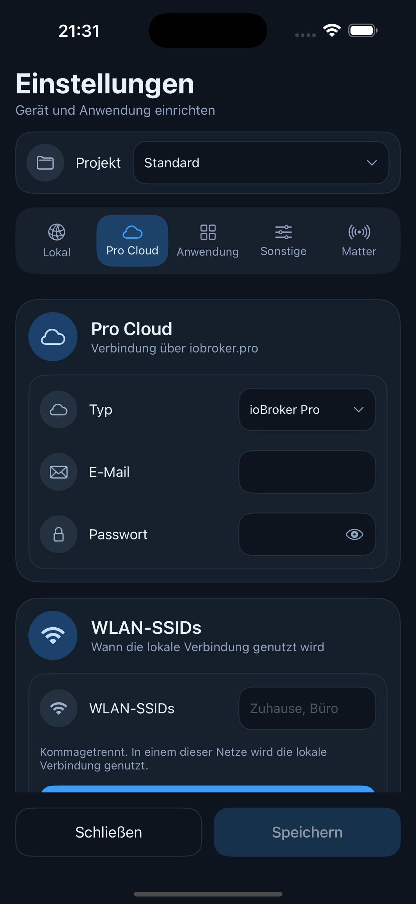 | 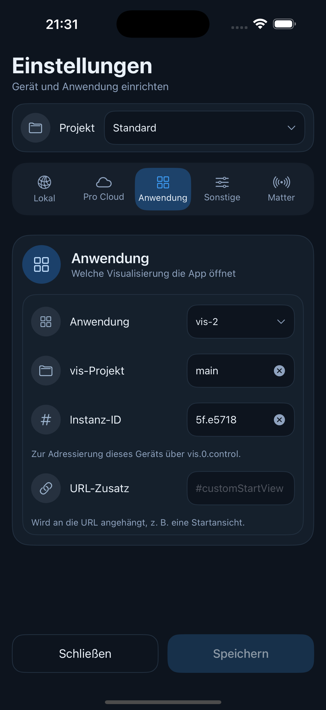 |

| Others | Matter |
|---|---|
| 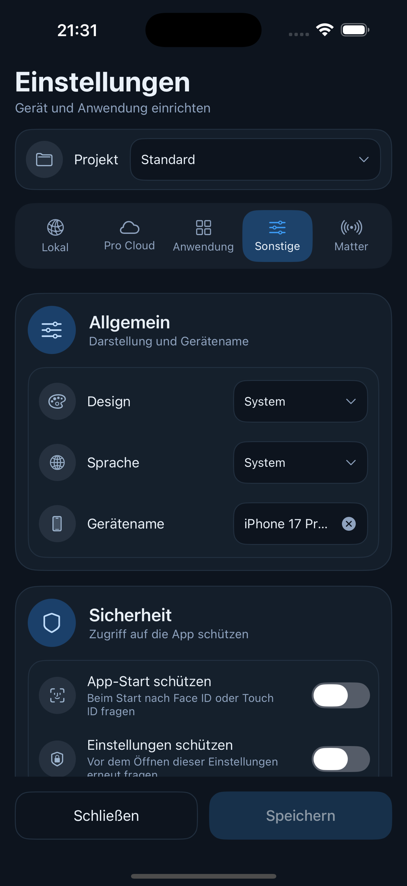 | 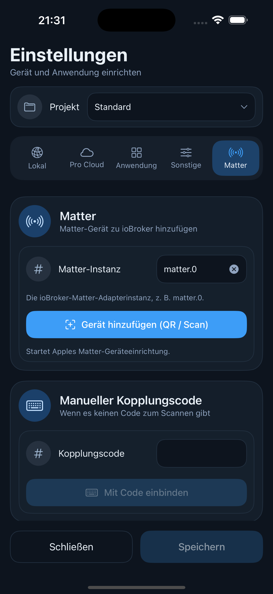 |

On the iPad the same tabs use the full width:

| Local | Pro Cloud | Application |
|---|---|---|
| 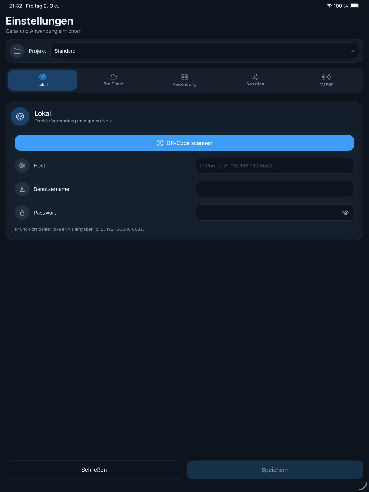 | 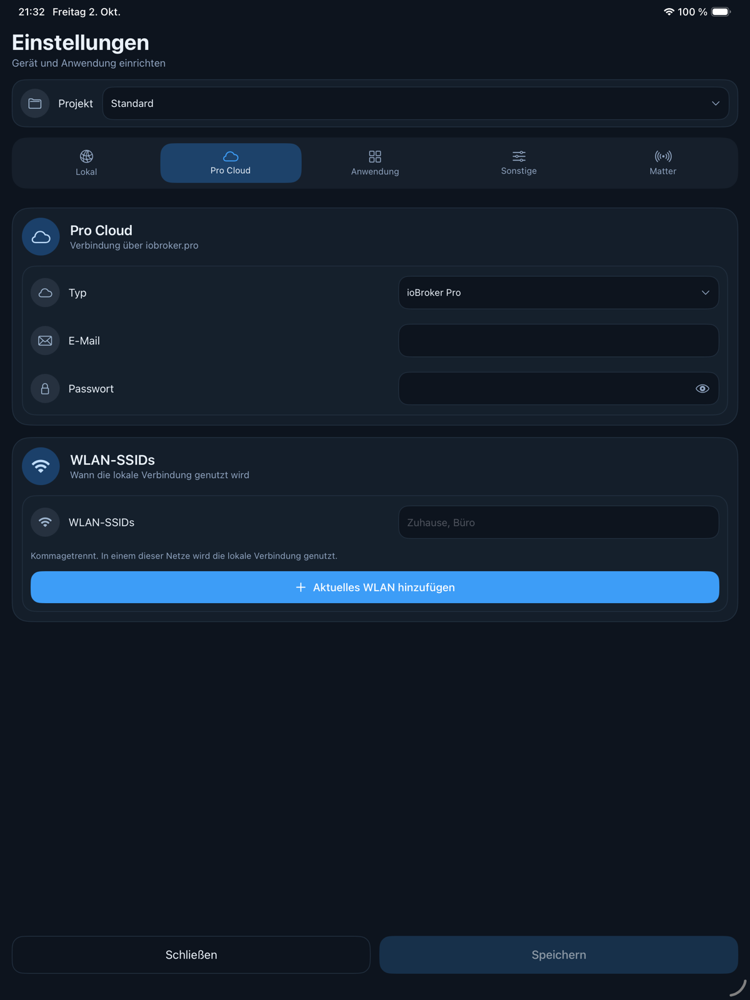 | 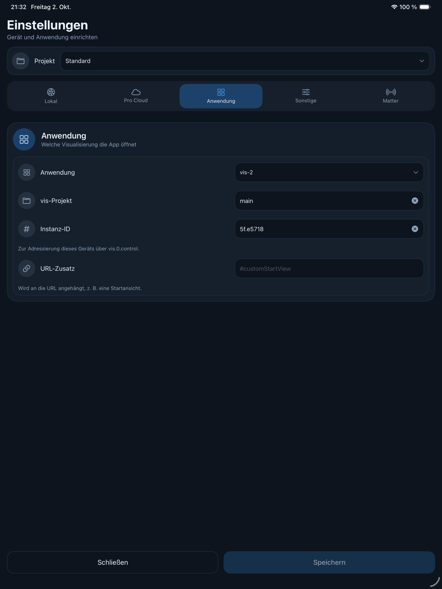 |

| Others | Matter |
|---|---|
| 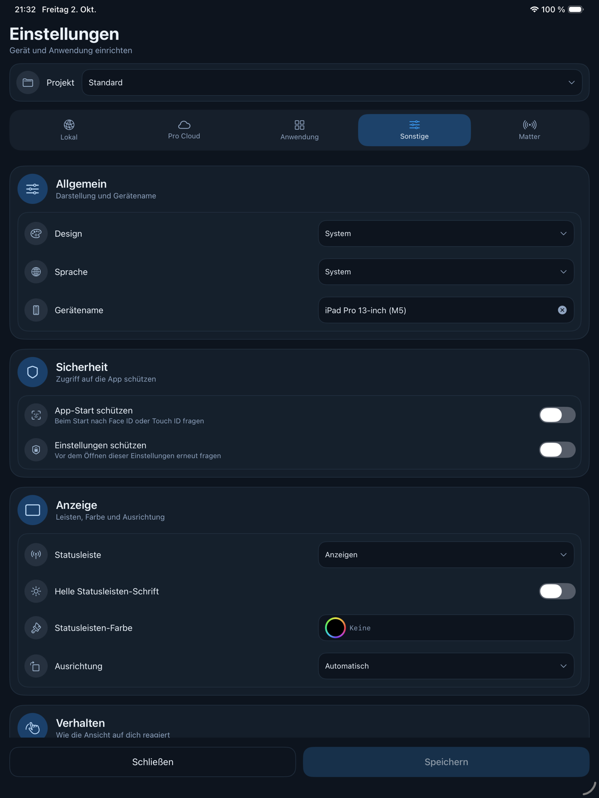 | 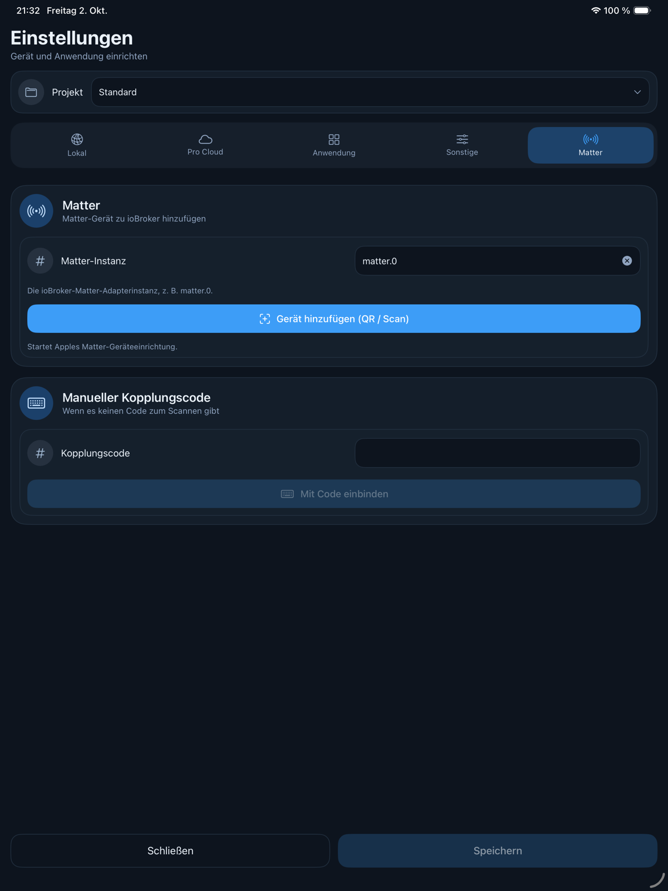 |

*Official App Store screenshots. The app is developed continuously, so details may differ in
a newer release.*

---

## What the app does

The app renders the visualization that already runs on your ioBroker installation inside a
tuned full-screen `WKWebView`, and adds the things Safari cannot do: a saved connection,
automatic local/remote switching, home-screen widgets, push notifications, device sensors,
Matter commissioning and kiosk behaviour.

The iOS app and the Android app share one settings model, so every option means the same
thing on both — the differences are listed under [Differences from
Android](#differences-from-android).

### Supported visualizations

`vis-2` · `devices` · `vis` · `lovelace` · `material` · `jarvis` · `iQontrol` · `habpanel` · `aura`

The chosen type only decides which URL the app opens, so anything else reachable on your web
instance can be used as well. The default port is **8082**, except for `lovelace`, which
defaults to **8091**.

### Connection

- **Local** — IP and port of your web instance, e.g. `192.168.1.10:8082`. A bare `IP:PORT`
  is completed automatically; `https://` may be given explicitly. An optional user name and
  password perform an automatic login. The address the app will really open — scheme, port
  and path included — is shown under the field. Since iOS 14 a local address also needs the
  *Local Network* permission; when it is off, the Local tab says so instead of reporting a
  server that does not answer.
- **Pro Cloud** — your [ioBroker.pro](https://iobroker.pro) account for access from outside.
  The subscription is validated against the cloud, and a Pro logo can be shown in the corner
  while the cloud connection is in use.
- **Custom cloud** — instead of ioBroker.pro, any self-hosted URL. The corner badge then reads
  `remote` instead of `.pro`.
- **Wi-Fi SSIDs** — a comma-separated list of your home networks. While connected to one of
  them the app uses the local URL, otherwise the cloud. iOS hands out the Wi-Fi name only with
  the location permission; while it cannot be read, the app asks the local installation whether
  it answers rather than going to the cloud.
- **Self-signed certificates** — can be accepted per project (tab *Others*) for local HTTPS
  instances. A refused certificate is named instead of being reported as "no connection".
- **QR code setup** — the Local tab has a scanner for the `iotConfig` code produced by
  ioBroker, which fills in port, IP, cloud user and password in one step.
- **Session recovery** — an expired session produces no error, only a redirect to a login
  page. The app renews the session cookie before it expires, renews again when it returns to
  the foreground, and recognises a login page by its URL to log in silently and return to the
  page you were on. This is what keeps a permanently mounted iPad logged in.

### Home-screen widgets

Two tile types — a **Toggle** that switches a state, and an **Analog** tile that shows a
numeric value as a number, half-circle gauge, horizontal or vertical bar. They come in two
flavours: an **overview** widget that shows the first configured tiles and works on every
supported system, and a **single** widget you point at one chosen tile, which needs iOS 17.

➡️ **[widgets.md](widgets.md) — how widgets update and what you have to configure.**

### Push notifications

Messages sent from ioBroker (`iot.0.app.message`, optionally with `app.title`, `app.expire`
and `app.priority`) arrive as iOS notifications with action buttons; the tapped action is
written back to ioBroker. A notification can target specific devices by name and can carry a
URL to open. Push requires a valid ioBroker.pro account.

### Device telemetry

The app can report back into ioBroker: **battery** level and charging state, **screen
brightness** (bidirectional — writing the state dims the device), **location**, **Wi-Fi
SSID**, **connection type**, a **device name** and an online indicator. Two destinations are
selectable: the `cloud` adapter (states appear under `cloud.X.devices.<device>`) or directly
under `vis.0.<device>.<field>`.

While the visualization is on screen the app reports on its own connection every 45 seconds.
Off screen, `BGTaskScheduler` runs a round roughly every 15 minutes — iOS decides the exact
moment, so the cadence is a target, not a guarantee. For a device that must report
continuously there is an opt-in mode that keeps the process alive through location updates;
it costs the "Always" location permission and the visible location indicator.

### Microphone, camera and sound

A page may use the microphone and the camera — an intercom or a doorbell widget, for example.
iOS asks once for the permission; WebKit does not ask again on every page load. Sounds may play
without a tap first, so a ring tone is heard on a display nobody has touched.

> WebKit offers the microphone and the camera only to pages loaded over **HTTPS** (ioBroker.pro,
> or a local instance with a certificate). Over plain `http://<ip>` a page cannot use them;
> playing sounds works either way.

### Remote control (REST interface, compatible with Fully Kiosk)

ioBroker can play a sound, speak a text, set the brightness or open a page on the iPad — through
the same REST interface as the Android app, which is the one of **Fully Kiosk Browser**. The
[ioBroker.fullybrowser](https://github.com/arteck/ioBroker.fullybrowser) adapter works with it
unchanged.

> **Only while the app is on screen.** iOS suspends an app shortly after it leaves the screen and
> lets no app keep a server running in the background. For a wall-mounted iPad switch on *Keep
> display awake* and keep the app in front, e.g. with *Guided Access*. A locked iPad cannot be
> woken by any app.

**Setup:** *Others* → *Remote control*: switch on the REST interface, set a password and save.
The card shows the address, e.g. `http://192.168.1.30:2323`. In ioBroker.fullybrowser add the
device with protocol `http`, this IP, port `2323` and the password. Opened in a browser without a
password, the address shows a page to try the commands on.

```
http://192.168.1.30:2323/?cmd=textToSpeech&text=Es%20klingelt&locale=de_DE&password=…&type=json
http://192.168.1.30:2323/?cmd=playSound&url=http%3A%2F%2F192.168.1.10%3A8082%2Fding.mp3&password=…
```

| Command | Parameters | iOS |
|---|---|---|
| `deviceInfo` / `listSettings` | | Battery, brightness, current page, IP, volume … as JSON |
| `textToSpeech` / `stopTextToSpeech` | `text=`, `locale=de_DE`, `queue=1` | ✅ also with the silent switch on |
| `playSound` / `stopSound` | `url=`, `loop=true` | ✅ MP3 or WAV from a URL, also with the silent switch on |
| `setStringSetting` | `key=screenBrightness&value=0…255` | ✅ kept across restarts |
| `startScreensaver` / `stopScreensaver` / `triggerMotion` | | ✅ dim / restore |
| `screenOff` / `screenOn` | | ⚠️ black screen at minimum brightness and back — the panel stays on |
| `loadURL` / `loadStartURL` / `refreshTab` / `restartApp` | `url=` | ✅ |
| `setOverlayMessage` / `showToast` | `text=` | ✅ |
| `getScreenshot` | | ✅ PNG of the page |
| `clearCache` / `clearCookies` / `clearWebstorage` | | ✅ |
| `vibrate` | | iPhone only |
| `setAudioVolume`, `toBackground`, `exitApp`, `startApplication`, `setBooleanSetting` | | ❌ `Not supported on iOS` |

### Matter

The app ships an Apple `MatterSupport` device-setup extension. Scanning a device's QR code
hands the commissioning over to the ioBroker matter adapter, which adds the device to your
installation.

### Geofence

Named locations with a radius; entering or leaving one writes a boolean state under
`iot.0.app.geofence.<name>`, which the adapter creates on first use. The radius is typed —
at least 100 m, at most what the device can monitor — and the coordinates can be typed or set
on the map. A new fence reports its state right away, so the state appears without having to
leave the place first.

### Kiosk / wall-panel behaviour

Keep the display awake · dim to a chosen level after N seconds of inactivity and restore on
the next tap · return to the start page after N seconds · lock the orientation · show, hide
or make transparent the status bar (with a free colour) · hide the home indicator · force full
screen · fixed zoom with two decimals (e.g. `1.15`), separately for portrait and landscape and
applied as soon as the device is turned, or automatic zoom · allow or block scrolling and
zooming.

### Projects

Up to **3 projects**, each with its own connection, visualization and appearance. A long
press on the app icon offers one Quick Action per project; starting the app through a Quick
Action locks it to that project until it is restarted.

### Protection

Face ID / Touch ID can be required for the app start and for opening the settings,
independently of each other.

---

## Settings reference

The settings screen opens with a **three-finger tap** on the visualization, and is organised
in five tabs: **Local**, **Pro Cloud**, **Application**, **Others** and **Matter**.
The project selector sits above the tabs.

### Local

| Setting | Meaning |
|---|---|
| Host IP:PORT | Address of the web instance, e.g. `192.168.1.10:8082`. `https://` allowed |
| User name / Password | ioBroker user for the automatic login |
| QR scanner | Reads an `iotConfig` code and fills in the fields |
| Address used | Shown under the field: the complete address the app will open |

### Pro Cloud

| Setting | Meaning |
|---|---|
| Cloud type | `Pro` (iobroker.pro) or `Custom` |
| Cloud URL | Only for `Custom` |
| User name / Password | ioBroker.pro account — also enables push notifications |
| Wi-Fi SSIDs | Comma-separated home networks; inside them the local URL is used |

### Application

| Setting | Meaning |
|---|---|
| Application | `vis-2`, `devices`, `vis`, `lovelace`, `material`, `jarvis`, `iQontrol`, `habpanel`, `aura` |
| Project | vis project name, default `main`. The projects found on the installation are offered; if there is only one, it is chosen |
| URL postfix | Appended to the URL, e.g. `#myStartView` |
| Instance ID | Identifies this device for `vis.0.control` (switch views, detect the active view) |

### Others

Grouped into the cards **General**, **Security**, **Display** and **Behaviour**:

| Setting | Card | Meaning |
|---|---|---|
| Theme | General | System, light or dark |
| Language | General | App language: system, English, German, Russian |
| Device name | General | Name used for the states of this device |
| Protect app start | Security | Ask for Face ID / Touch ID at launch |
| Protect settings | Security | Ask again before this settings screen opens |
| Status bar | Display | Shown, hidden or transparent |
| Light status bar text | Display | Light text for dark status bar backgrounds |
| Status bar colour | Display | Free colour via the colour picker |
| Hide home indicator | Display | Fades the bar at the bottom edge out while the screen is not touched |
| Orientation | Display | Automatic, or locked to portrait or landscape |

The **Behaviour** card holds the rest — how the view reacts to you:

| Setting | Meaning |
|---|---|
| Allow zoom / Allow scrolling | Enable or block the gestures in the WebView |
| Zoom (portrait) / Zoom (landscape) | Fixed initial scale per orientation, typed with two decimals |
| Automatic zoom | Sets `width=device-width`, so the page scales itself |
| Force full screen | Sets `viewport-fit=cover` |
| Reload on orientation change | Helps with views that do not re-layout cleanly |
| Pull to refresh | Enable or disable the reload gesture |
| Keep display awake | Prevents the screen from turning off |
| Dim after seconds / Dim to level | Dim after inactivity, restore on the next tap (`0` = off) |
| Back to start page after seconds | Return to the start view after inactivity (`0` = off) |
| Reload when the app becomes active | Hard reload when returning from the background (on by default on iOS) |
| Show Pro logo | Indicator in the corner while the cloud connection is in use |
| Telemetry target | `cloud` adapter or `vis.0` |
| Battery / Location / Brightness | Which device values are reported |
| Report permanently in the background | Keeps reporting alive through location updates; needs the "Always" permission |
| Accept self-signed certificates | For local HTTPS instances with their own certificate |
| REST interface | On/off, port, password — see [Remote control](#remote-control-rest-interface-compatible-with-fully-kiosk) |

### Matter

Selection of the matter instance and the commissioning dialog.

---

## Gestures

| Gesture | Effect |
|---|---|
| Three-finger tap | Open the settings |
| Pull to refresh | Reload the page — only when the page is already scrolled to the top |
| Tap after dimming | Restore the previous brightness |
| Long press on the app icon | Start a specific project (Quick Action) |

The first visualization the app ever shows carries a short hint about the three-finger tap,
once. A visualization can also open the settings itself, which is the dependable way on a wall
display where three fingers are awkward:

```js
window.ReactNativeWebView.postMessage(JSON.stringify({ command: 'openSettings' }));
```

---

## Differences from Android

| Topic | iOS |
|---|---|
| Interactive widgets | Writing from the tile itself needs iOS 17. On iOS 16 a tap opens the app, which performs the write |
| Reload gesture | Pull to refresh instead of the two-finger double tap |
| Navigation bar | iOS has none; the setting hides the home indicator instead. iOS only fades it out — a touch brings it back for a moment |
| Several visualizations in one project | Android only so far — on iOS a project shows one visualization |
| Remote control (REST interface, Fully Kiosk compatible) | Only while the app is on screen — iOS lets no app keep a server running in the background. No system volume, no waking a locked screen, no starting other apps |
| Background reporting | `BGTaskScheduler`; iOS decides the cadence, so a round is not guaranteed every 15 minutes |
| Matter | Apple's `MatterSupport` extension instead of Google Play Services |
| VPN detection | Not available — iOS does not let an app read or control the VPN state |

---

## Troubleshooting

| Symptom | Cause / remedy |
|---|---|
| Settings open on every start | The connection test failed — check IP, port, credentials and whether the web instance is running |
| Blank page | Wrong application type or wrong project name; check the port (8082, lovelace 8091) |
| Works at home, not outside | No cloud configured, or the Wi-Fi SSID list is missing, so the app keeps trying the local address |
| Keeps returning to the login page | Credentials wrong, or the user lacks permission for the view |
| Local connection fails, although Safari reaches the address | The *Local Network* permission is off — Settings → Privacy & Security → Local Network → ioBroker Visu |
| "SSL error" instead of the page | The certificate is self-signed or issued for another name — enable *Accept self-signed certificates* in the *Others* tab |
| Microphone or camera do not work in the page | Only available over HTTPS — see [Microphone, camera and sound](#microphone-camera-and-sound) |
| Pull to refresh does not trigger | By design — it only works when the page is already at the top, so that reading up a long view does not reload it |
| Widget tile stays empty | See [widgets.md](widgets.md) — usually the `/state/` endpoint of the web adapter |
| Single-tile widget not offered | It needs iOS 17; on iOS 16 use the overview widget |
| No push notifications | ioBroker.pro credentials missing or invalid; push is tied to a valid Pro account |
| Background values arrive irregularly | Expected on iOS — the system schedules the background rounds |

---

## Reporting a bug

[Open an issue](https://github.com/ioBroker/Android-And-iPhone-Apps/issues/new/choose) and
include the iOS version, the device model, the app version (bottom of the settings screen),
the visualization used and the connection type. Redact IP addresses, user names and passwords
in screenshots.
